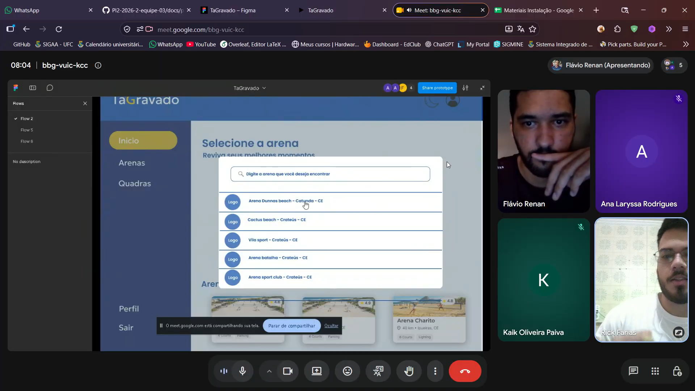
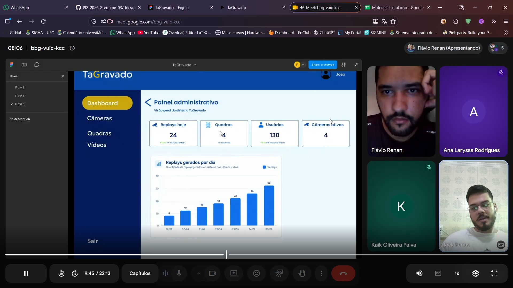

# Relatório de Usabilidade – Sprint 5

## 1. Objetivo

Acompanhar o cliente durante a utilização do protótipo do TaGravado para verificar se as telas e funcionalidades estavam claras e se a navegação era fácil de entender.

## 2. Como foi realizado o teste

Foi realizada uma reunião com o cliente, na qual apresentei o protótipo no Figma e acompanhei sua navegação pelas telas.

Durante a reunião, foram explorados o fluxo inicial do sistema e as funcionalidades dos perfis de cliente/gestor.

Enquanto o cliente utilizava o protótipo, observei se ele tinha dúvidas, dificuldades para encontrar alguma opção ou problemas para entender o funcionamento das telas.

## 3. Fluxos avaliados

| Fluxo | O que foi testado |
|---|---|
| Inicial | Navegação pelas telas iniciais e acesso às funcionalidades. |
| Cliente/Gestor | Funcionalidades de gerenciamento da arena, como quadras, câmeras, patrocinadores e vídeos. |

## 4. Observações durante os testes

Durante a reunião, o cliente demonstrou compreender bem as funcionalidades apresentadas. Não percebi hesitações ou dificuldades durante a navegação pelos fluxos testados.

| Fluxo | Comportamento observado | Resultado |
|---|---|---|
| Inicial | Compreendeu a navegação e as opções apresentadas. | Sem dificuldades observadas. |
| Cliente/Gestor | Entendeu as funcionalidades de gerenciamento da arena. | Sem dificuldades observadas. |

## 5. Resultado da avaliação

De modo geral, a reunião teve um resultado positivo. O cliente conseguiu compreender como o sistema funciona e a finalidade das funcionalidades apresentadas.

Durante os testes, não foram percebidas dificuldades que indicassem a necessidade de alterações nas telas por questões de usabilidade.

## 6. Evidências

**Fluxo inicial**

**Fluxo do cliente/gestor**

## 7. Considerações finais

A reunião foi importante para verificar se o cliente conseguia entender e utilizar as funcionalidades planejadas para o TaGravado.

A avaliação foi positiva, pois ele compreendeu as telas e os fluxos apresentados, sem demonstrar dificuldades durante a navegação. Não foram identificadas necessidades de ajustes de usabilidade a partir dos testes realizados.