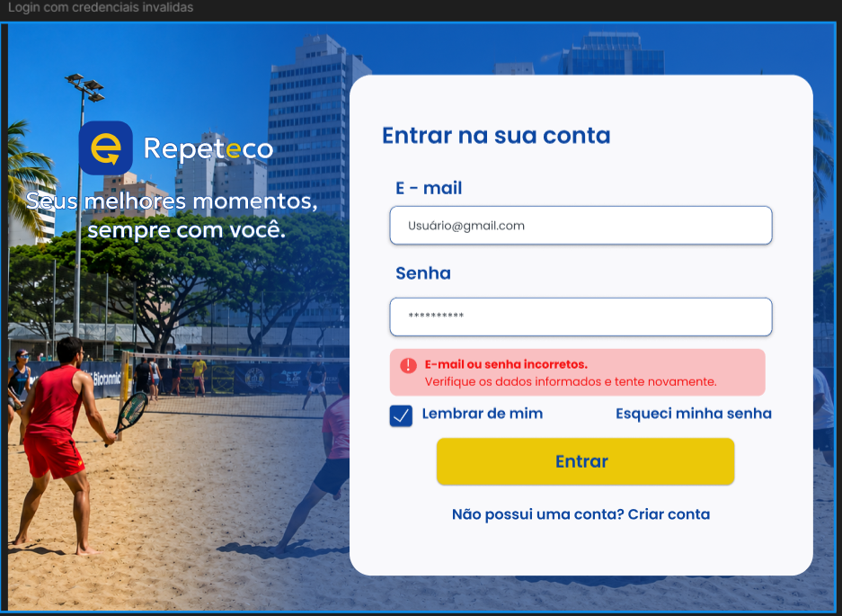
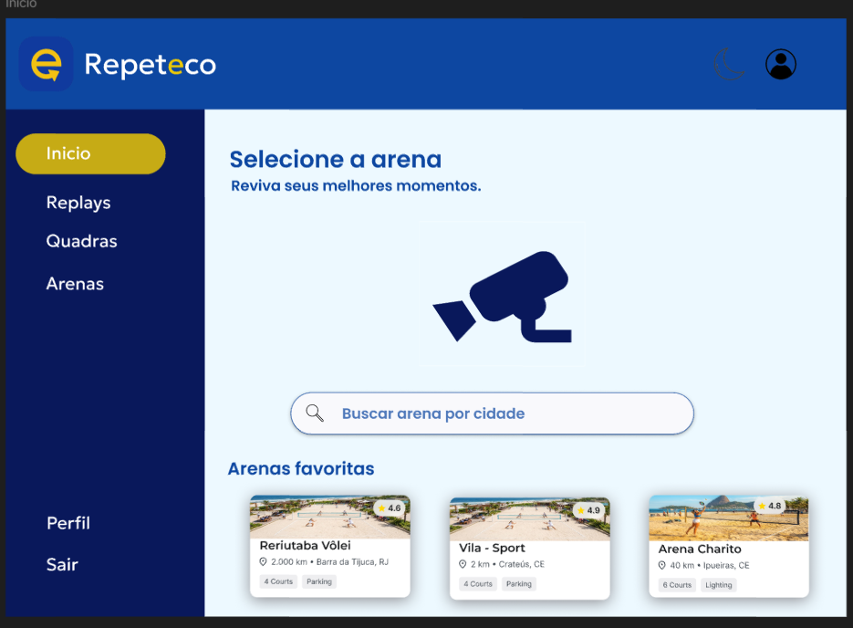
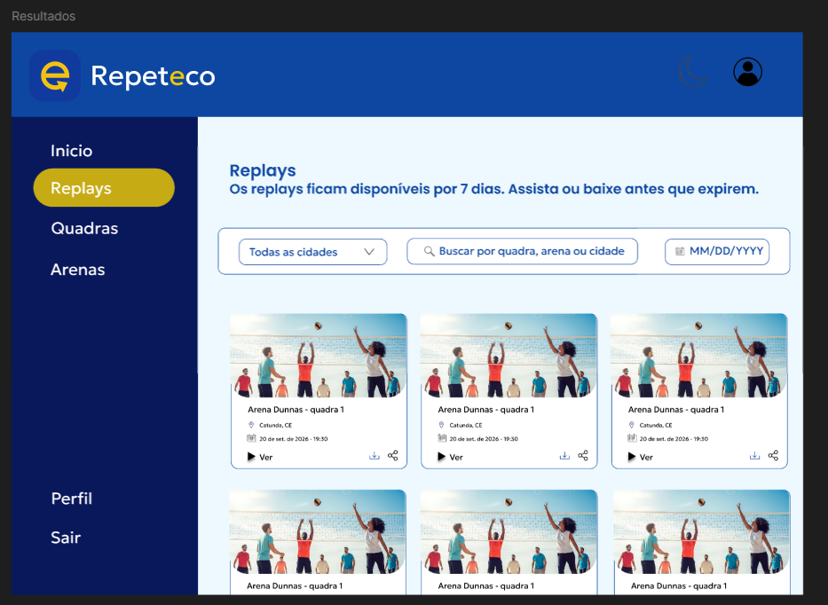

# Revisão de UX Writing — Repeteco

## 1. Objetivo

Documentar as melhorias de UX Writing realizadas nas interfaces do sistema Repeteco, buscando tornar os textos mais claros, objetivos e compreensíveis para os usuários.

## 2. Telas revisadas

Nesta seção, serão registradas as telas que receberam alterações de UX Writing.

### 2.1. Tela: login com credenciais invalidas

**Alterações realizadas:**
Mensagem indicando melhor o que o usúario deve fazer após a mensagem de erro das credenciais invalidas

**Evidência:**

 

### 2.2. Tela: Tela inicial 

**Alterações realizadas:** mensagem mais clara informando o que o usuario deve pesquisar

**Evidência:**

 

### 2.3. Tela: Resultados

**Alterações realizadas:**
Mensagem de exclusão de videos mais clara, informando que após 7 dias os videos serão excluidos

**Evidência:**

 

## 4. Considerações finais

A revisão de UX Writing contribuiu para melhorar a comunicação entre o sistema Repeteco e seus usuários, priorizando textos mais claros, objetivos e consistentes com as funcionalidades da aplicação.

As alterações foram aplicadas ao protótipo no Figma e documentadas neste arquivo para registro e acompanhamento das melhorias realizadas.