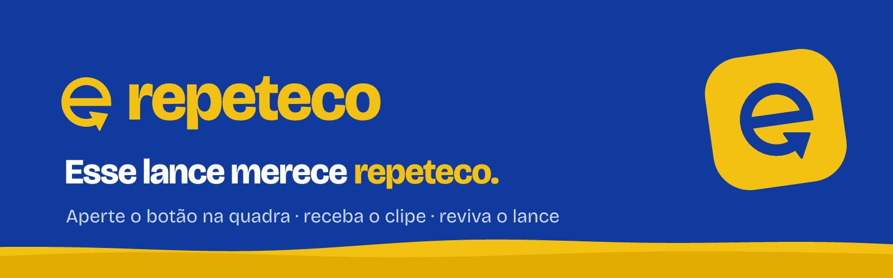
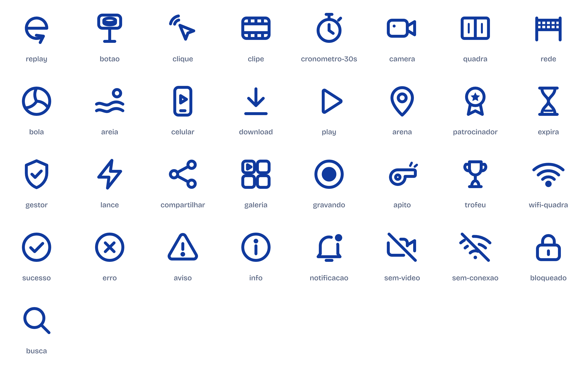
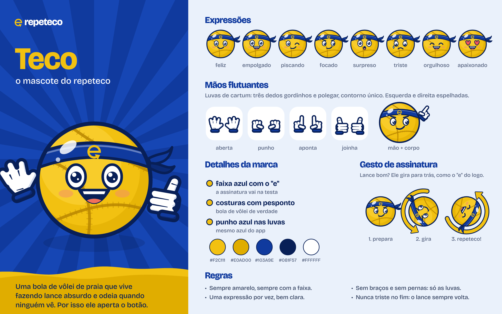
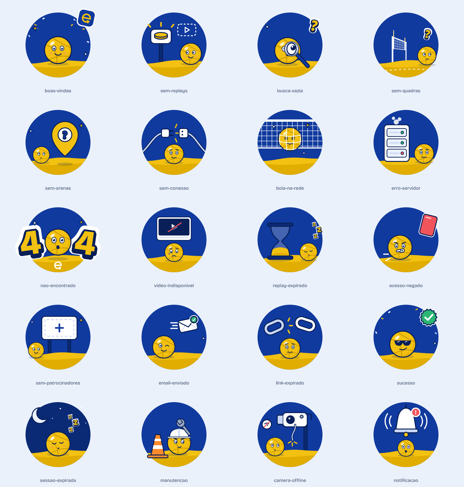

# repeteco · guia da marca

> **Esse lance merece repeteco.**
> Apertou o botão na quadra, o replay é seu.

Este pacote reúne logo, símbolo, artes para redes, ícones, figurinhas, ilustrações de estado do app, loadings e motion graphics do **repeteco**, o sistema de replay para quadras de areia do Projeto Integrador 2 (equipe 03). Tudo é gerado por código (pasta [`fonte/`](./fonte) e [`motion/projeto/`](./motion/projeto)): para mudar uma cor ou um texto, edite o gerador e rode de novo, sem redesenhar à mão.



---

## 1. Conceito

O símbolo é um **"e" minúsculo que termina numa seta de replay**. Na animação ele se desenha, a seta "estala" e o "e" **rebobina** (gira –360°), o mesmo movimento do loader.

**Por que um "e"?**

1. **É a letra que se repete.** "r**e**p**e**t**e**co" tem três "e", um a cada duas letras. O nome fala de repetir, e a letra que mais se repete nele vira o símbolo.
2. **O "e" já tem a forma de um replay.** O "e" minúsculo é um círculo que quase fecha, como o ícone ↺. A seta entra na ponta aberta sem deformar a letra: ela é letra e botão de replay ao mesmo tempo.
3. **A seta aponta para trás.** Quem escreve um "e" faz o traço do meio e contorna no sentido anti-horário, que é o sentido de voltar. A seta só continua o movimento da caneta: é rever o lance.
4. **Ele gira e continua sendo ele.** Por ser redondo, o "e" dá uma volta inteira para trás e segue legível em qualquer ângulo. Esse giro é o loader do app, a vinheta dos vídeos e o gesto de assinatura do mascote, o Teco.
5. **"E de novo!"** Em português, o "e" também é a palavra que puxa a repetição.

| Peça | Arquivo |
|---|---|
| Logo principal (fundo claro) | [`logo/svg/logo-horizontal.svg`](./logo/svg/logo-horizontal.svg) |
| Logo sobre azul | [`logo/svg/logo-horizontal-branco-amarelo.svg`](./logo/svg/logo-horizontal-branco-amarelo.svg) |
| Símbolo (app, favicon, avatar) | [`logo/svg/simbolo.svg`](./logo/svg/simbolo.svg) |

## 2. Versões do logo

Todas em SVG (texto já convertido em curvas, não depende de fonte instalada) e PNG em 800 px e 2400 px (símbolos em 512 e 1024 px), em [`logo/`](./logo).

| Arquivo | Quando usar |
|---|---|
| `logo-horizontal` | padrão, fundos claros |
| `logo-horizontal-negativo` | fundos azuis, com o símbolo em amarelo |
| `logo-horizontal-branco-amarelo` | fundos azuis/escuros, sem caixa (header do app, vídeos) |
| `logo-horizontal-sem-fundo-azul` | fundos claros, sem caixa |
| `logo-horizontal-amarelo` | cabeçalhos de peças azuis (como no banner do slogan) |
| `logo-vertical` / `logo-vertical-negativo` | espaços quadrados ou altos |
| `logo-mono-azul` / `-branco` / `-preto` | impressão em 1 cor, carimbos, marca d'água |
| `wordmark-*` | só a palavra |
| `simbolo`, `simbolo-amarelo`, `simbolo-escuro`, `simbolo-circulo` | ícone de app, avatar, favicon |
| `simbolo-e-*` | só o "e", sem caixa |

**Regras rápidas**
- Área de proteção: metade da altura do símbolo em volta do logo.
- Tamanho mínimo: símbolo com 20 px; logo horizontal com 96 px de largura.
- Não distorcer, não girar o logo estático (só a animação gira o "e"), não aplicar sombra nem contorno, não trocar as cores fora das versões acima.
- O nome é sempre minúsculo: **repeteco**.

## 3. Cores

| Nome | Hex | Uso |
|---|---|---|
| Azul Quadra | `#103A9E` | fundo principal, logo em fundo claro (= `--tg-brand-blue` do front) |
| Azul Noite | `#0B2A75` | variações escuras, sombras (= `--tg-brand-blue-dark`) |
| Azul Fundo | `#081F57` | traços do mascote, poste do botão |
| Amarelo Areia | `#F2C111` | símbolo, destaques, uma palavra por frase (= `--tg-brand-yellow`) |
| Areia Funda | `#E0AD00` | segunda camada das ondas de areia |
| Gelo | `#EAF1FB` | fundos claros (= `--tg-brand-bg`) |
| Lilás Claro | `#C9D6F5` | texto de apoio sobre azul |

Regra de ouro: **uma cor de destaque por vez**. Numa frase, só uma palavra vai em amarelo.

## 4. Tipografia

- **Bricolage Grotesque** ExtraBold (800) no logo, nos títulos das peças e nos motions. Medium/Regular nos textos de apoio. Gratuita (OFL), no [Google Fonts](https://fonts.google.com/specimen/Bricolage+Grotesque).
- No app, a interface continua com **Poppins** e **Geologica** (já configuradas em `src/style.css`). O logo é SVG, então não exige carregar a Bricolage no front.

## 5. Elemento de apoio: a areia

Duas ondas amarelas no pé das peças (`#F2C111` em cima, `#E0AD00` embaixo) lembram a quadra de areia. Use em banners, vídeos e telas de abertura, sempre encostadas na borda de baixo.

## 6. Artes para redes e repositório ([`social/`](./social))

| Arquivo | Tamanho | Para quê |
|---|---|---|
| `slogan.png` | 2400×1260 | peça do slogan (recriação da original) |
| `og-image-1200x630.png` | 1200×630 | preview de link (WhatsApp, Slack, LinkedIn) |
| `github-social-preview.png` | 1280×640 | *Settings → Social preview* dos repositórios |
| `readme-banner.png` | 1600×500 | topo dos READMEs |
| `post-1080.png` | 1080×1080 | post de feed |
| `story-1080x1920.png` | 1080×1920 | stories / status |
| `avatar.png` | 1000×1000 | foto da organização no GitHub e redes |
| `capa-3000x1000.png` | 3000×1000 | capa de LinkedIn/Notion/YouTube |
| `carrossel-como-funciona/01…06.png` | 1080×1350 | carrossel: rolou o lance → aperta o botão → 30 s viram clipe → baixa no celular |
| `stories/story-conheca-o-teco.png`, `story-aperta-o-botao.png` | 1080×1920 | stories / status |
| `frases/ninguem-viu-o-teco-viu.png`, `foi-ponto-tem-prova.png` | 1080×1080 | posts de frase |

## 7. Ícones ([`icones/`](./icones))

33 ícones de traço (24×24, traço 2 px, pontas arredondadas, `currentColor`). Seguem as regras de grade de bibliotecas de ícones de traço como a [Lucide](https://lucide.dev/guide/design/icon-design-guide): 1 px de margem livre na borda, nada encostando na borda do quadro, e ~2 px de folga entre partes que não se tocam (o ponto do sino e o risco dos ícones "sem" não encostam no desenho). As costuras do ícone `bola` terminam exatamente no contorno.

- **do produto:** replay, botão, clique, clipe, cronômetro 30 s, câmera, quadra, rede, bola, areia, celular, download, play, arena, patrocinador, expira, gestor, lance, compartilhar, galeria, gravando, apito, troféu, wifi da quadra.
- **de status** (toasts, alertas, banners): sucesso, erro, aviso, info, notificação, sem vídeo, sem conexão, bloqueado, busca.

- `svg/`: um arquivo por ícone.
- `app/`: o mesmo ícone num quadrado azul de 512 px (apresentações, docs, slides).
- `repeteco-icons.tsx`: componentes React prontos (`<IconeReplay className="size-5" />`).



## 8. Mascote e figurinhas ([`emojis/`](./emojis))

O **Teco** é a bola de vôlei da marca. 15 figurinhas em SVG e PNG (512 e 128 px, fundo transparente, borda branca de adesivo), prontas para WhatsApp, Slack e Discord:

`teco-oi`, `teco-uau`, `teco-risada`, `teco-craque`, `teco-fogo`, `teco-zzz`, `teco-apaixonado`, `teco-tonto`, `botao-clique`, `selo-salvo`, `selo-30s`, `balao-de-novo`, `balao-repeteco`, `replay-ja`, `quadra-areia`.

Animadas em [`emojis/animados/`](./emojis/animados) (GIF e WebP): `teco-quicando`, `teco-risada`, `teco-fogo`, `teco-dormindo`, `replay-girando`, `repeteco-pulsando`, `salvo-carimbo`, `botao-clique`.

## 8.1 O Teco detalhado ([`teco/`](./teco))

A versão "de cena" do mascote, para pôsteres, posts e vídeos (as figurinhas acima continuam como estão). Ele ganha faixa azul com o "e" na testa, costuras com pesponto, luz e sombra, e **mãos flutuantes**: luvas de cartum brancas com punho azul, sem braços, para a silhueta continuar redonda. A referência é a luva clássica de desenho animado: três dedos gordinhos e curtos mais o polegar, palma "fofa", ponta redonda. Cada luva é uma silhueta única (`fonte/maos.py`), com um contorno contínuo um pouco mais fino que o do corpo, vincos internos que afinam para dentro e uma sombra de volume com a mesma luz do corpo (do alto, à esquerda). São quatro poses (aberta, punho, apontando com o indicador, joinha 👍 com os dedos dobrados em rolinhos), com esquerda e direita espelhadas e o polegar sempre virado para dentro. O gesto de assinatura é **girar para trás**, como o "e" do logo.

- [`teco/ficha/ficha-do-teco.png`](./teco/ficha/ficha-do-teco.png): ficha do personagem (expressões, mãos, detalhes, cores, gesto e regras).
- `teco/cenas/`: 5 pôsteres 4:5: `conheca-o-teco`, `teco-aperta-o-botao`, `teco-lance-absurdo`, `teco-rebobina`, `teco-replay-no-celular`.



## 9. Ilustrações de estado ([`ilustracoes/`](./ilustracoes))

Cenas para os momentos em que o app não tem o que mostrar: lista vazia, erro, vídeo que não carrega, aviso. Cada uma fica num palco redondo azul com areia, então serve no tema claro e no escuro sem variação. O Teco faz o papel principal. Elas têm animação leve em CSS dentro do próprio SVG (funciona em ``), que para sozinha com `prefers-reduced-motion`.

Regra de composição: tudo fica dentro do palco. Só as "figurinhas" com borda branca (o ponto de interrogação, o 404, o selo de ok, o cartão vermelho, o tile do "e") podem passar da borda, de propósito. Estrelas, confetes e risquinhos são puxados para dentro pelo próprio gerador.

- `svg/`: o arquivo para usar no front (480×360, 8 a 15 KB cada).
- `png/`: 960 px, para slides, docs e e-mails.
- `capas/`: `capa-arena`, `capa-quadra` e `capa-replay` (16:9, recortam bem em qualquer proporção) para a mídia que não tem imagem, e `avatar-teco` para perfil sem foto.

| Arquivo | Para quê |
|---|---|
| `boas-vindas` | primeiro acesso, home sem histórico, fim do cadastro |
| `sem-replays` | galeria de replays vazia (convida a apertar o botão na quadra) |
| `busca-vazia` | busca e filtros que não encontraram nada |
| `sem-quadras` | listagem de quadras vazia ou filtro sem quadras |
| `sem-arenas` | listagem de arenas vazia ou cidade sem arenas |
| `sem-conexao` | falha de rede ou API fora do ar (QueryErrorState) |
| `bola-na-rede` | erro genérico (exceção inesperada, ação que falhou) |
| `erro-servidor` | erro 5xx, serviço indisponível |
| `nao-encontrado` | rota inexistente (404) e replay/arena/quadra que não existe mais |
| `video-indisponivel` | player sem arquivo, vídeo que falhou ao carregar |
| `replay-expirado` | replay cujo prazo acabou (ReplayExpiry = expirado) |
| `acesso-negado` | rota/ação sem permissão (RequireRole, ForbiddenDialog) |
| `sem-patrocinadores` | lista de patrocinadores vazia (espaço disponível) |
| `email-enviado` | recuperação de senha enviada, confirmação de cadastro |
| `link-expirado` | link de redefinição de senha expirado ou inválido |
| `sucesso` | ação concluída: solicitação enviada, senha alterada, dados salvos |
| `sessao-expirada` | sessão que expirou, pedido para entrar de novo |
| `manutencao` | sistema em manutenção ou recurso temporariamente desligado |
| `camera-offline` | câmera da quadra sem sinal (painel do gestor/admin) |
| `notificacao` | central de avisos, alerta importante, novidade |



No front, `<Ilustracao nome="sem-conexao" />` e `<EmptyState ilustracao="sem-replays" … />` (veja a seção 12).

## 10. Loading ([`loading/`](./loading))

O "e" se desenha, a seta estala, ele rebobina e se desfaz. Ciclo de 1,8 s.

- `loader-*.svg`: SVG animado só com CSS (funciona em ``), com versões amarela, azul, branca, em caixa e `cor-atual` (`currentColor`). Respeita `prefers-reduced-motion`.
- `RepetecoLoader.tsx`: componente React com `role="status"` e texto para leitor de tela.
- `loader-*.gif` / `.webp` / `loader-tela-azul.mp4`: para slides, vídeos e lugares sem CSS.

## 11. Motion graphics ([`motion/`](./motion))

| Arquivo | Formato | Duração |
|---|---|---|
| `repeteco-manifesto-16x9.mp4` | 1920×1080 | 27 s |
| `repeteco-manifesto-9x16.mp4` | 1080×1920 (Reels/Stories) | 27 s |
| `repeteco-manifesto-1x1.mp4` | 1080×1080 (feed) | 27 s |
| `repeteco-vinheta-16x9.mp4` | 1920×1080 | 5,6 s |
| `repeteco-vinheta-1x1.mp4` | 1080×1080 | 5,6 s |
| `repeteco-vinheta.gif` | 960×540 | 5,6 s (para o README) |
| `teco-apresenta-9x16.mp4` | 1080×1920 (Reels/Stories) | 15 s |
| `teco-apresenta-1x1.mp4` | 1080×1080 (feed) | 15 s |
| `teco-apresenta-16x9.mp4` | 1920×1080 | 15 s |
| `teco-loop-1x1.mp4` / `teco-loop.gif` | 1080×1080 / 540×540 | 4 s em loop (o Teco quica e rebobina) |

Roteiro do "Teco apresenta": *Esse é o Teco.* (ele cai na areia e acena) → *Ele vive fazendo lance absurdo.* (salta por cima da rede dando cambalhota) → *E odeia quando ninguém vê.* (olha em volta, fica triste) → *Então ele aperta o botão.* → *Repeteco!* (gira para trás com o arco de replay) → *O lance volta pra você.* (abraça o celular com o clipe salvo) → logo + *Esse lance merece repeteco.* Projeto em [`motion/teco/`](./motion/teco).

Roteiro do manifesto: *Aquele lance absurdo na areia…* → *…que ninguém conseguiu rever?* (abrir as câmeras, achar o horário, mandar pro cliente, riscados) → *Aperta o botão.* → *Os 30 segundos anteriores viram clipe.* → *Direto no seu celular.* → logo + *Esse lance merece repeteco.*

Como editar e renderizar de novo: [`motion/LEIA-ME.md`](./motion/LEIA-ME.md).

## 12. No front

Logo em componente React (mesma API do `Logo` atual), loader, ícones, ilustrações de estado (com o `EmptyState`, o `QueryErrorState`, o player e as capas de mídia já usando elas), favicons, manifest e imagem de preview. Esse kit é mantido no repositório [pi2-frontend](https://github.com/PI2-2026-2-equipe-03/pi2-frontend), não aqui — esta cópia da pasta `marca/` é só a fonte de referência visual (logo, cores, ícones, ilustrações, motion), sem a pasta `front-kit/`.

## 13. Regenerar tudo

```bash
cd marca/fonte
pip install "fonttools[woff]" uharfbuzz pillow shapely
npm i @resvg/resvg-js
./gerar_tudo.sh
```

O símbolo e a palavra saem da mesma geometria (`fonte/brand.py`), e o Teco sai de um só desenho (`fonte/teco.py`), então logo, ícones, figurinhas, ilustrações, loader, front e vídeos ficam sempre iguais entre si.
