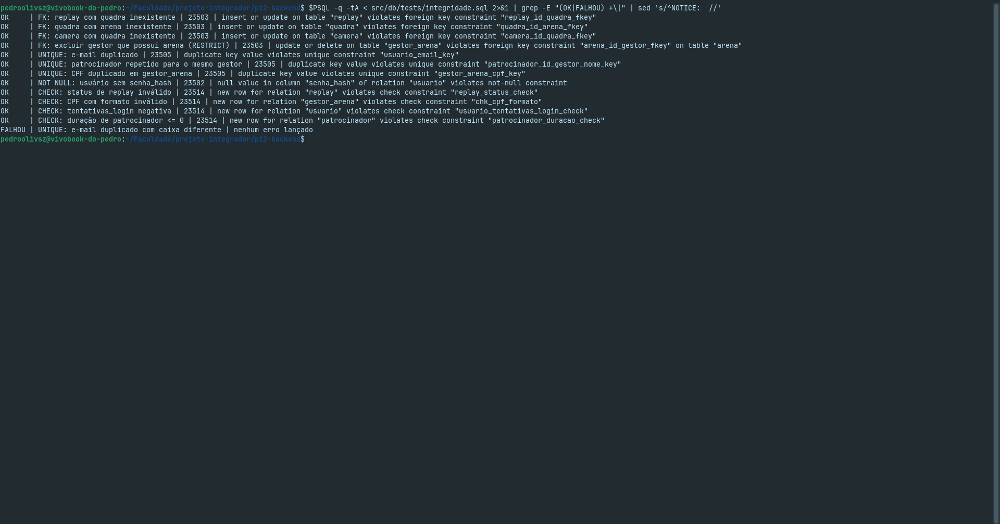
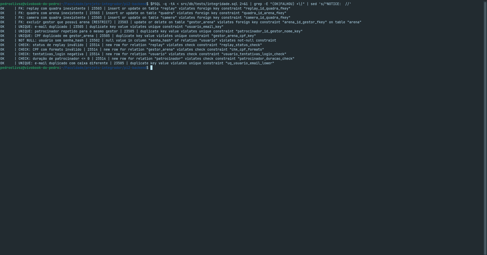
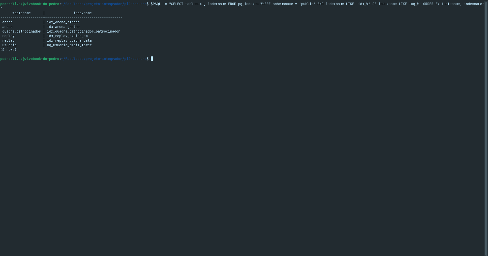
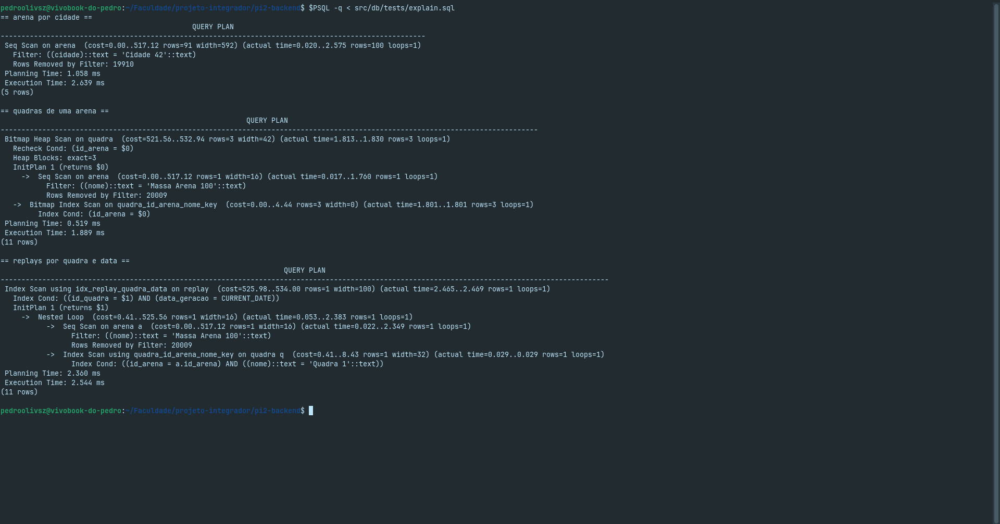
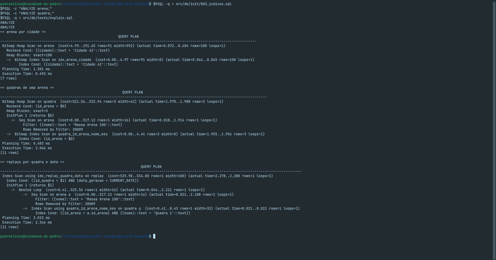

# Índices do banco — TaGravado

Issue: B3-01. Os índices abaixo cobrem as buscas do fluxo de navegação
(cidade → arena → quadra → data/horário → replay) e as rotinas de limpeza.

| Índice | Tabela | Colunas | Consulta atendida | Origem |
|---|---|---|---|---|
| usuario_email_key | usuario | email | Login e verificação de e-mail duplicado | 001_schema |
| uq_usuario_email_lower | usuario | lower(email) | Unicidade sem distinção de maiúsculas/minúsculas | 003_indices |
| idx_arena_cidade | arena | cidade | Busca de arenas por cidade | 003_indices |
| idx_arena_gestor | arena | id_gestor | Arenas de um gestor; evita seq scan no DELETE de gestor_arena (FK) | 003_indices |
| idx_quadra_arena | quadra | id_arena | Quadras de uma arena; FK sem índice automático | 003_indices |
| camera_id_quadra_identificador_key | camera | (id_quadra, identificador) | Câmeras de uma quadra (prefixo id_quadra) | 001_schema |
| idx_replay_quadra_data | replay | (id_quadra, data_geracao, hora_geracao) | Busca de replays por quadra, data e horário | 001_schema |
| idx_replay_expira_em | replay | expira_em (parcial: status <> 'excluido') | Job de exclusão automática após 7 dias (RF-08) | 001_schema |
| patrocinador_id_gestor_nome_key | patrocinador | (id_gestor, nome) | Patrocinadores de um gestor; evita duplicidade | 001_schema |
| quadra_patrocinador_pkey | quadra_patrocinador | (id_quadra, id_patrocinador) | Patrocinadores de uma quadra | 001_schema |
| idx_quadra_patrocinador_patrocinador | quadra_patrocinador | id_patrocinador | Quadras de um patrocinador; FK sem índice | 003_indices |

## Observações
- Chaves primárias e constraints UNIQUE já criam índice automaticamente.
- Com poucas linhas o planner prefere Seq Scan; as evidências foram geradas com massa sintética (100 mil replays) e ANALYZE.
- Busca por cidade com ILIKE ou sem acento não usa idx_arena_cidade; se necessário, criar índice sobre lower(cidade).

## Evidências

### 1. Testes de integridade
Script: `src/db/tests/integridade.sql`. Cada teste executa uma operação inválida dentro de uma transação (com ROLLBACK ao final) e confirma que o banco a rejeita com o código de erro esperado.

| Tipo de restrição | Código | Casos testados |
|---|---|---|
| FOREIGN KEY | 23503 | replay com quadra inexistente; quadra com arena inexistente; câmera com quadra inexistente; exclusão de gestor com arena (RESTRICT) |
| UNIQUE | 23505 | e-mail duplicado; e-mail duplicado com caixa diferente; patrocinador repetido por gestor; CPF duplicado |
| NOT NULL | 23502 | usuário sem `senha_hash` |
| CHECK | 23514 | status de replay inválido; CPF com formato inválido; `tentativas_login` negativa; duração de patrocinador ≤ 0 |

Execução antes de aplicar `003_indices.sql` (o teste de e-mail com caixa diferente falha, como esperado):

Execução depois de aplicar `003_indices.sql` (todos os testes OK):

### 2. Índices criados
Consulta em `pg_indexes` após aplicar `003_indices.sql`:

### 3. EXPLAIN ANALYZE
Massa sintética gerada por `src/db/tests/massa.sql` (20 mil arenas, 60 mil quadras, 120 mil replays), seguida de `ANALYZE`. Consultas em `src/db/tests/explain.sql`.

Antes dos índices (Seq Scan em `arena` e `quadra`):

Depois dos índices (Index Scan / Bitmap Index Scan):

A busca de replays por quadra e data já usava `idx_replay_quadra_data` nos dois cenários, pois o índice vem do `001_schema.sql`.