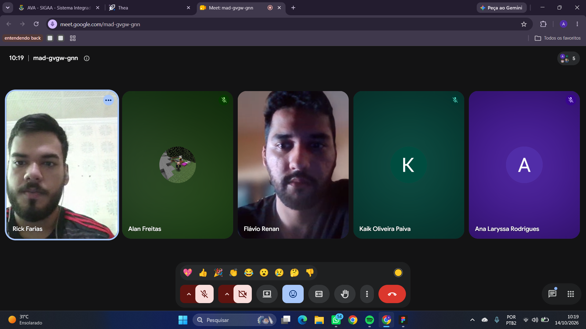

# Validação do Protótipo — Sprint 3

## 1. Identificação

- **Projeto:** TaGravado
- **Equipe:** PI2-2026-2-equipe-03
- **Atividade:** D3-01 — Finalização do Protótipo
- **Cliente parceiro:** Arena Dunnas Beach
- **Data da reunião:** 14/10/2026
- **Modalidade:** Reunião remota pelo Google Meet

## 2. Objetivo

Validar o protótipo de alta fidelidade do sistema TaGravado,
verificando se as telas, os fluxos de navegação e as
funcionalidades representadas atendem às necessidades
apresentadas pelo cliente parceiro.

## 3. Atividades realizadas

Durante a reunião, o protótipo do sistema TaGravado foi
apresentado ao cliente parceiro para avaliação e validação.

A apresentação teve como objetivo verificar a organização
das telas, a navegação entre as interfaces e a representação
das funcionalidades previstas para o sistema.

## 4. Link do protótipo no Figma

**https://www.figma.com/design/zLz9JwG8iKX8twcxCNoUO2/TaGravado?node-id=0-1&t=3FrA2CcmL1EaHBMR-1**

## 5. Resultado da validação

**Status: APROVADO PELO CLIENTE**

A reunião de validação foi realizada com o cliente parceiro,
que demonstrou satisfação com o protótipo apresentado,
afirmando que estava ótimo e que estava tudo certo,
confirmando sua aprovação.

Conforme o retorno recebido durante a reunião, não foram
solicitadas alterações adicionais naquele momento.

## 6. Evidências da validação

A captura de tela abaixo registra a realização da reunião
de validação por meio do Google Meet, com a participação
dos integrantes presentes.

## 7. Conclusão

A etapa de validação do protótipo foi concluída com a
aprovação do cliente parceiro.

O resultado foi registrado nesta documentação, acompanhado
da evidência da reunião e do link de acesso ao protótipo,
para facilitar a consulta e o acompanhamento das atividades.
